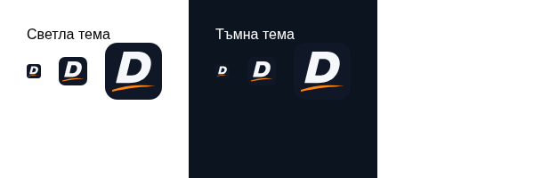

# Dido — одобрен вариант Б

**Вариант Б е одобрен от собственика и вече е основното графично лого в хедъра и футъра на feat/dido-v0-6-logo. PR #3 не е сливан; production main не е променян.**

[Векторен SVG — вариант Б](../public/branding/logo-dido-runner-b.svg) · [CMS настройки и fallback](DIDO-v0.6-logo.md)

## Desktop — реален хедър, 1440 px

## Телефон — реален хедър, 320 и 390 px

Снимките са от реално заредената страница след избора, без подмяна на SVG от браузърния тест. И хедърът, и футърът зареждат logo-dido-runner-b.svg. Потвърдени са същите височини на хедъра 73/73/77/79 px при 320/390/768/1440 px и същите ширини на логото 108/108/108/128 px. Няма хоризонтален overflow или JavaScript page errors; менюто, кликът към началната и runtime fallback са проверени.

При празно **Собствено лого** Pages CMS използва вариант Б. Собствено изображение продължава да има предимство; изключване на графичното лого или липсващ/незареден файл връща текста. Настройките, site.json, размерите и CSS са запазени.

## Favicon — непроменен

Предходните SVG предложения и сравнението А/Б са запазени само за справка на **/branding/variants.html**. Вариант А не е активен. Пълният build се запазва от GitHub Actions като artifact **dido-static-preview**, а съществуващата Cloudflare интеграция обновява само branch preview. Merge и production публикуване остават за отделно окончателно одобрение.
